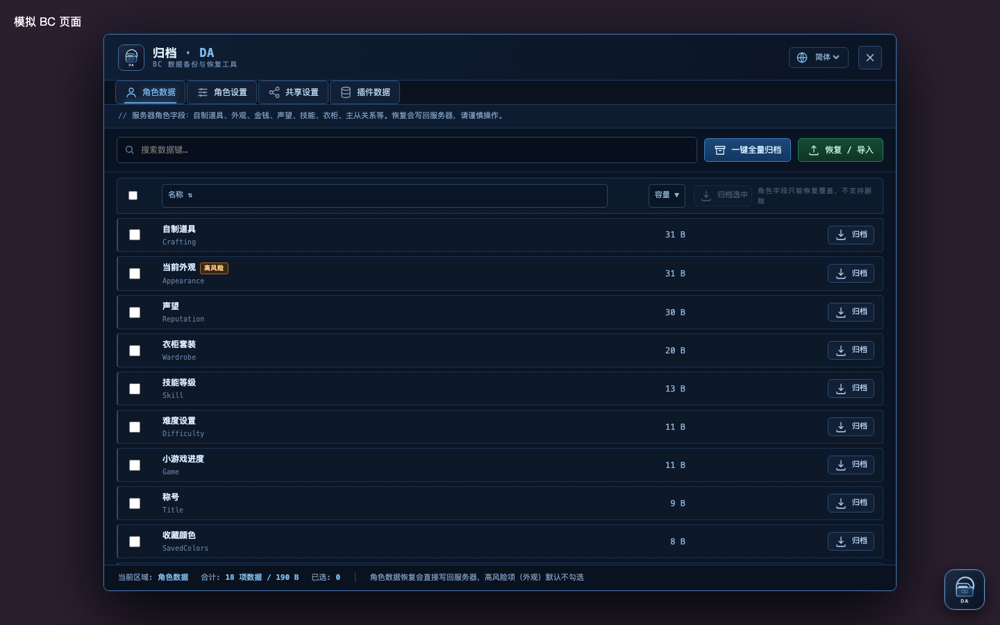

# 归档 · DA — BC 数据备份与恢复工具

> Bondage Club 的一键数据备份 / 恢复插件。极客风界面、三语适配、导入导出动画。
>
> [简体中文](README.md) · [English](README.en.md)
>
> 📋 [更新记录 / Changelog](CHANGELOG.md)

点上面按钮（或下面 *安装* 里的链接）会直接打开 raw 脚本，弹出油猴的安装提示——不用复制粘贴。

**自动更新**：油猴里装的只是一个 2KB 的轻量加载器，核心代码托管在 GitHub Pages。每次打开 BC 页面都会动态拉取最新版核心代码（带时间戳绕开缓存）——作者 push 更新后，你**刷新页面就生效**，不用在油猴里手动更新，也不用重装。

---

## 它能做什么

把你在 BC 里攒的东西打包成一个 JSON 文件存到自己电脑，需要时再导回来。

**能备份 / 恢复四类数据**：

| 区域 | 包含什么 |
|---|---|
| 角色数据 | 衣柜、自制道具、当前外观、金钱、声望、技能、主从恋人关系、收藏颜色等 |
| 角色设置 | LSCG、EmeryBC 等插件存放在角色账号上的设置 |
| 共享设置 | FCM 好友、个人资料背景等跨房共享的设置 |
| 插件数据 | 服装缓存、聊天记录、OutfitManager 等浏览器本地数据 |

**主要功能**：

- **一键全量归档**：先勾选要存哪些区域（默认全选），再打包成一个 JSON，弹系统保存框让你选位置
- **精细归档**：只存某一项，或勾选中的几项
- **恢复 / 导入**：选备份文件 → 看新旧值对比和校验结果 → 勾选要恢复的项 → 二级确认 → 覆盖
- **数据校验**：账号不符、类型错误、空数据、体积异常都会标出来，异常项禁止导入
- **极客风 UI**：深蓝终端风、自定义勾选框、悬停 / 长按功能提示、导入导出进度动画
- **三语**：简体 / 繁體 / English，面板内即时切换
- **按插件归类**：第五个标签「按插件」把三个区的数据按插件聚合，可整包备份某个插件（跨区打包成一个 JSON），或二次确认后一键清空该插件全部数据；支持多选批量操作
- **中文识别**：英文数据键名（如 `LSCG_Outfits`）自动显示中文说明「LSCG 调教游戏 · 套装」，覆盖 99% 常见插件，保留原始键名方便对照
- **备份提醒**：可设「关闭 / 每 7 天 / 每 15 天 / 每 30 天 / 自定义天数」。到期在面板顶部显示提醒横幅（带「立即备份 / 今天不提醒」），登录就绪后每天最多弹一次 toast。备份成功后自动重置计时。提醒设置与上次备份时间存在浏览器本地

---

## 你的数据存在哪里（重要）

**存在你自己的电脑里，不上传任何云端服务器。**

- 点归档 → 浏览器弹出系统「保存文件」对话框 → 你选位置 → 生成一个 `.json` 文件
- 插件不会把你的数据发到 GitHub、也不发到任何第三方
- GitHub 上只有插件**代码**，没有你的游戏数据

**换设备 / 换电脑怎么办**：把那个 `.json` 文件拷到新设备 → 在新设备打开 BC → 点 DA 按钮 → 「恢复 / 导入」→ 选这个文件 → 按提示恢复。

---

## 怎么打开

插件装好后有两种打开方式：

1. **人物资料页**：进入**自己的**人物资料页（Information Sheet），左下角人物立绘旁边有一个深蓝色的 **DA** 方形按钮，点它打开面板。
2. **聊天指令**：在聊天窗口输入 `/da` 回车即可打开，**不区分大小写**（`/DA`、`/Da`、`/dA` 都可以）。

> 只有一个入口，设置页不放按钮，避免界面拥挤。

---

## 恢复后要不要刷新游戏

看恢复的是哪类数据：

| 恢复的内容 | 需要做什么 |
|---|---|
| 角色数据（外观、道具、金钱等） | 提交到服务器后，**重新登录**才能完整生效 |
| 角色设置 / 共享设置 | 一般会自动同步；没立即刷新就切个页面或重登 |
| 插件数据（localStorage） | 写入即生效；个别插件自己有缓存，可能要重载那个插件 |

---

## 安装

### 自动安装（推荐）

装了 Tampermonkey 或 Violentmonkey 后，点顶部那个安装按钮，或直接打开：

<https://raw.githubusercontent.com/heitaoplay/BC-DataArchive/main/BC-DataArchive.user.js>

会弹出安装确认页，点「安装」即可。

### 支持的服务器

- `bondageprojects.elementfx.com`
- `bondage-asia.com`
- `bondage-europe.com`

（含各自的 `www.` 版本）

---

## 兼容与依赖

- 需要 **bcModSdk**（BC 模块开发套件）。如果你装了 BCX 或其他主流 BC 插件，它已经在了
- 已适配 **R134** 的资料页 DOM 按钮机制
- 遵循 ModSDK 注册规范，BCX 兼容性检查不会报 "Unknown mod"

---

## 来源与授权

容量管理面板的核心逻辑提取自 [awdrrawd/BC-LCE](https://github.com/awdrrawd/BC-LCE) 的 `src/settings/storage-manager.js`，原作者 **Likolisu**，采用 **AGPL-3.0**。

依据协议保留原作者署名，本衍生作品同样遵循 **AGPL-3.0**。
